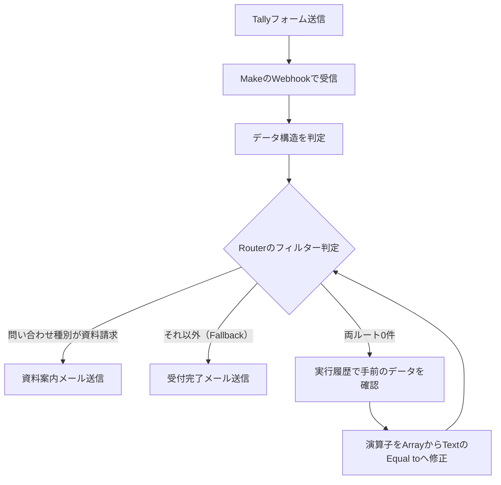

# Makeでフォーム→自動仕分け→メール送信を作った話：Router分岐が「両方0件」になった原因と解決

問い合わせフォームに来た内容を、人が目視で分類して転送している——中小企業の現場でよくある作業です。この記事では、ノーコード自動化ツール「Make」でフォーム送信からメール送信までを自動化した実際の手順と、途中でハマった「分岐がどちらにも流れない」問題の原因と解決を、実際の作業ログそのままに書きます。

**図：フォーム送信からメール自動返信までの流れ**

## 今回作ったものと、解決したい実務課題

作ったのは、次の流れを自動で処理するシナリオ（Makeでは自動化の処理フロー全体を「シナリオ」と呼びます）です。

1. Tallyフォーム（無料で使えるWebフォーム作成サービス）で問い合わせを受ける
2. 送信された内容をMakeがWebhook（外部サービスからデータを受け取る専用URL）で受信する
3. Router（ルーター。処理を複数ルートに枝分かれさせる部品）で「資料請求」と「一般問い合わせ」に自動仕分けする
4. それぞれに合った内容のメールを自動送信する

これは学習の「Phase 2で学んだ条件分岐」と「Phase 3で学んだTallyフォーム連携」を合体させた集大成の課題でした。

実務でどこが助かるかというと、こういう作業です。

- フォームの通知メールを見て、担当者が「これは資料請求だな」と判断して資料を添付して返信する
- 一般の質問は別の担当に転送する
- 返信が業務の合間になるので、どうしても数時間〜翌日になる

この「目で見て分類して、手で返信する」部分が丸ごと自動化できます。人が判断しているように見えて、実は「どの選択肢を選んだか」で機械的に決まっているケースは本当に多い。そこを切り出すのが自動化の第一歩です。

## 組み立ての手順（再現できる粒度で）

### 1. Tally側でフォームを用意する

問い合わせ種別を**選択肢（ラジオボタンやドロップダウン）**にしておくのがポイントです。自由記述にすると表記ゆれ（「資料請求」「資料希望」「カタログください」）で分岐が組めなくなります。

### 2. MakeでWebhookモジュールを置く

- Makeで新規シナリオを作り、最初のモジュールに「Webhooks > Custom webhook」を追加
- 生成されたURLをコピー
- Tallyの連携設定（Integrations）でWebhookのURLとして貼り付ける

### 3. 一度テスト送信してデータ構造を覚えさせる

ここは飛ばしがちですが必須です。Makeの「Determine data structure（データ構造の判定）」を待機状態にして、実際にTallyフォームから1件テスト送信します。これをやらないと、後のステップで項目（フィールド）が選択肢に出てこず、手入力することになります。

### 4. Routerで2ルートに分ける

Webhookの次に「Router」を追加し、ルートを2本作ります。それぞれのルートの入り口にあるフィルター（条件設定）で、

- ルートA：問い合わせ種別が「資料請求」のとき
- ルートB：それ以外

という条件を設定します。

### 5. 各ルートにメール送信モジュールを置く

資料請求ルートには資料案内の文面、一般ルートには受付完了の文面を設定します。本文にはWebhookで受け取った氏名などの項目を差し込めます。

## つまずいた点と解決：Routerの両ルートが0件になった

組み上げて実行したら、**両方のルートに1件も流れない**という状態になりました。エラーは出ない。Webhookはデータを受け取っている。なのにRouterから先が空っぽ。

原因は、**フィルター条件で使う演算子（オペレーター）の種類を取り違えていた**ことでした。

Makeのフィルター設定では、条件の演算子がカテゴリごとに分かれています。

- **Text operators**（テキスト用）：`Equal to`、`Contains`、`Starts with` など、文字列を比較するもの
- **Array operators**（配列用）：`Contains`、`Equal to` など、**複数の値が入った箱（配列）**に対して使うもの

名前が似た演算子が両方のカテゴリにあるのが、わかりにくさの元です。私は文字列を比較したいのにArray operatorsの方を選んでしまっていました。配列用の演算子は、比較対象が「配列」であることを前提にしているので、ただの文字列を渡しても一致と判定されません。結果、どちらのルートの条件も成立せず、全部スルーされて0件になっていたわけです。

**解決の手順はこうでした。**

1. まずRouterの手前で処理を止め、Webhookが受け取った生データを確認した
2. 問い合わせ種別の値が、ちゃんと文字列として入っていることを確認した
3. 「文字列なのに配列用の比較をしている」とわかり、フィルターの演算子をText operatorsの`Equal to`に変更した
4. 再実行して、資料請求ルートに正しく1件流れた

**ここから学んだ教訓**は2つです。

- **エラーが出ない＝正しい、ではない。** 条件に合わないものは静かにスルーされるだけです。「0件」は正常終了に見えてしまう。
- **デバッグは必ず「手前のデータ」から見る。** 条件式をあれこれ書き換えるより、「そもそもどんな値が来ているか」を目で見る方が早い。Makeは実行履歴で各モジュールの入出力をそのまま確認できるので、これを使わない手はありません。

製造業の設備トラブルと同じで、センサーの値を見ずに制御プログラムをいじっても原因にはたどり着けません。入力を確認してから、ロジックを疑う。順番が大事です。

## 明日から使えるチェックリスト

フォーム→分岐→通知の自動化を組むときの確認項目です。

- [ ] 分岐の判断に使う項目は、自由記述ではなく**選択肢**にしてあるか
- [ ] Webhookを置いたら、**本番と同じ形で1件テスト送信**してデータ構造を読み込ませたか
- [ ] フィルターの演算子は、比較したい値の型（文字列か配列か）に合った**カテゴリ**を選んでいるか
- [ ] Routerのルートに「**それ以外（Fallback）**」の受け皿を必ず1本用意したか（これが無いと想定外の値が消える）
- [ ] 実行後、各モジュールの**入出力データを1回は目視確認**したか
- [ ] 「0件で終了」を見たとき、**正常ではなく異常を疑う**習慣があるか
- [ ] 本番に出す前に、各ルートに1件ずつ流して**全パターン通したか**

## まとめ

Makeの条件分岐とフォーム連携を合体させ、問い合わせの自動仕分けと返信までを動かせました。最大のハマりどころは「Text operatorsとArray operatorsの取り違え」で、エラーが出ないまま両ルート0件になる厄介な症状でした。自動化のデバッグは、ロジックより先に「入ってきたデータの中身」を見る——これが一番の近道です。

<!-- REVIEW:START -->
## 🔍 公開前チェック（自動精査）

### 事実確認

- [ ] 「生成されたURLをコピー」「Tallyの連携設定（Integrations）でWebhookのURLとして貼り付ける」→ 素材には「Tallyフォーム連携」としかなく、具体的な設定画面名・手順の記載なし。実際の操作名と一致するか要確認。
- [ ] 「Determine data structure（データ構造の判定）」を待機状態にしてテスト送信 → 素材に記載のない手順。実際に行ったか、Makeの正しい名称かを確認。
- [ ] 「Text operators（`Equal to`、`Contains`、`Starts with`）」「Array operators（`Contains`、`Equal to`）」の具体的な演算子名の列挙 → 素材は「Text operatorsとArray operatorsの取り違え」のみ。個々の演算子名まで確認したか不明。
- [ ] 解決手順の「1. Routerの手前で処理を止め」「2. 文字列として入っていることを確認」「4. 再実行して、資料請求ルートに正しく1件流れた」→ 素材は「自力で解決」とだけ。この4ステップの具体的プロセス・「1件流れた」という結果は素材に裏付けなし。
- [ ] 「それ以外（Fallback）」というルート設計 → 素材は「資料請求/一般」の2分岐。実装がFallback機能だったか、単なる条件ルートだったか要確認。
- [ ] 「Tallyフォーム（無料で使えるWebフォーム作成サービス）」「問い合わせ種別を選択肢（ラジオボタン/ドロップダウン）にした」→ 素材に料金体系・フィールド形式の記載なし。一般論としては妥当だが、実際にそう設定したかは不明。

### 主張・表現

- [ ] 「人が目視で分類して転送している——中小企業の現場でよくある作業です」→ 書き手の実体験か一般論か不明。根拠のない業界一般化。
- [ ] 「返信が業務の合間になるので、どうしても数時間〜翌日になる」→ 素材に業務実態の記録なし。想定なら「〜になりがちです」等に緩和を。
- [ ] 「製造業の設備トラブルと同じで、センサーの値を見ずに〜」→ 書き手の背景が素材から読み取れない。自身の経験でないなら比喩として明示を。
- [ ] 「配列用の演算子は、比較対象が『配列』であることを前提にしている〜一致と判定されません」→ 原因の技術的説明が断定的。素材は「取り違えが原因」までしか示していないため、推測であれば表現を和らげる。
- [ ] 「実際の作業ログそのままに書きます」→ 上記のとおり素材にない手順が多数含まれるため、この宣言は過大。

### 構成・読みやすさ

- [ ] Mermaid図内の「両ルート0件」→「実行履歴で確認」→「演算子を修正」はフロー（処理経路）ではなくデバッグ経緯。図の役割が混在しており誤読を招く。
- [ ] 「明日から使えるチェックリスト」が7項目と多く、本文と重複（選択肢化／テスト送信／演算子カテゴリ／0件を疑う）。本文との棲み分けを整理するか3〜4項目に絞ると締まる。
- [ ] 「Phase 2」「Phase 3」が読者に何を指すか未説明。学習カリキュラム内の用語なので、外部向けには補足か削除を。
- [ ] タイトルは「両方0件になった原因と解決」が主題だが、前半の手順パートが長い。トラブル解決を先に出す構成も検討の余地あり。

### 総合判定

- [ ] **事実確認必須** — 骨子（Router分岐・Text/Array演算子の取り違え・自力解決）は素材と一致するが、手順の詳細・解決プロセスの4ステップ・演算子名の列挙など、素材に裏付けのない具体記述が多数。公開前に実ログとの突合が必要。
<!-- REVIEW:END -->

