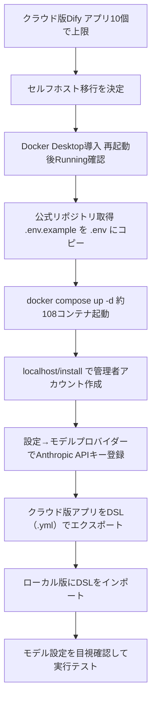

# クラウド版Difyのアプリ上限10個で詰んだので、Docker＋セルフホストに移行した話（実作業ログ）

Difyの無料プランでアプリを作り続けると、10個で頭打ちになります。この記事は「アプリをもっと作りたい」「社内データをクラウドに置きたくない」「でもDockerは触ったことがない」という中小企業の担当者向けに、実際にゼロからセルフホスト環境を立てて、クラウド版のアプリを移送するまでの手順と、途中でつまずいた点を記録したものです。

**図：クラウド版Difyからセルフホストへの移行手順**

## なぜセルフホストに切り替えたのか

きっかけは単純で、クラウド版Dify（SaaS版）の無料枠で作れるアプリ数が10個までだったからです。試作をいくつか作っているうちに、あっという間に上限に達しました。

ここで選択肢は3つあります。

1. 有料プランに課金する
2. 使っていないアプリを消して枠を空ける
3. セルフホスト（自分のPCやサーバーで動かす）に移行する

2は論外で、せっかく作った試作を消すのは本末転倒です。1も悪くないのですが、今回は3を選びました。理由は上限の話だけではありません。

- **アプリ数が無制限になる**：試作を消さずに増やし続けられる
- **データが社外に出ない**：製造業の現場では、図面名・工程名・取引先名が入った文章をクラウドに投げること自体がNGになるケースがあります。ローカルで動けばこの議論を丸ごと回避できます
- **月額費用がゼロ**：Dify自体の利用料はかからず、かかるのはAIモデル（今回はAnthropic）のAPI従量課金だけ

とくに2つ目は、社内でAI活用を提案するときの「持ち帰って検討します」を減らす効果があります。「このPCの中だけで動いています」と言えるのは強いです。

## 実際にやった手順

作業は大きく3ステップです。Dockerを入れる → Difyを起動する → APIキーをつなぐ。

### ステップ1：Docker Desktopを導入する

Dockerは、アプリを動かすのに必要な環境一式を「箱（コンテナ）」にまとめて動かす仕組みです。Difyは複数のソフトの組み合わせで動いているので、これを使わないと手作業での準備が現実的ではありません。

1. Docker Desktopの公式サイトからインストーラーをダウンロード
2. インストール後、PCを再起動
3. Docker Desktopを起動し、クジラのアイコンが「Running」になるのを確認

ここは素直に進みます。難しいのはこの後です。

### ステップ2：DifyをDocker Composeで起動する

1. Dify公式のGitHubリポジトリをダウンロード（またはgit clone）
2. `docker` フォルダに移動する
3. 設定ファイルのひな形 `.env.example` をコピーして `.env` という名前のファイルを作る
4. ターミナルで `docker compose up -d` を実行する
5. ダウンロードと起動が終わるのを待つ
6. ブラウザで `http://localhost/install` を開き、管理者アカウントを作成

`docker compose up -d` を打つと、必要な部品が次々にダウンロードされていきます。今回の環境では合計108個のコンテナが立ち上がりました。この数字を見た瞬間に「あ、これは手作業では絶対無理だ」と実感します。逆に言えば、Dockerを使えばコマンド1行でこれが全部揃うということです。

### ステップ3：Anthropic APIキーを接続する

セルフホスト版のDifyには、最初はAIモデルが一切つながっていません。ここがクラウド版との大きな違いで、知らないと「アプリを作ったのに何も返ってこない」状態になります。

1. Difyの画面右上のアカウントメニューから「設定」→「モデルプロバイダー」を開く
2. 一覧からAnthropicを選ぶ
3. Anthropicのコンソールで発行したAPIキーを貼り付けて保存
4. 保存後、モデル名（Claude系）が選択肢に出てくることを確認

APIキーは、AIサービスを使うための「鍵」です。使った分だけ課金されるので、金額の上限設定をコンソール側でしておくと安心です。

### ステップ4：クラウド版のアプリをDSLで引っ越す

ここが今回の山場であり、同時に一番あっけなく終わった部分でもあります。Difyには**DSL（アプリの設計図をファイル1つに書き出したもの）**でのエクスポート／インポート機能があります。

1. クラウド版Difyで対象アプリを開く
2. 右上のメニューから「DSLをエクスポート」を選び、`.yml` ファイルを保存
3. ローカル版Difyのアプリ一覧画面で「DSLファイルをインポート」を選ぶ
4. 保存した `.yml` を読み込ませる
5. アプリを開き、モデル設定が正しく割り当たっているか確認してから実行テスト

今回はクラウド版で作っていた旅行プラン作成アプリを移送し、ローカル版で同じように動くところまで確認できました。作り直しは一切不要です。

## つまずいた点と解決

**1. 「Dockerって何から入れるの？」で止まる**

Dockerの解説記事は、すでにDockerを知っている人向けに書かれているものが多く、最初の一歩が意外と見つかりません。結論としては、個人・小規模利用なら**Docker Desktopを公式サイトから入れるだけ**で十分です。Linuxのコマンドを覚える必要はありませんでした。

**2. 起動したのにモデルが選べない**

ローカル版を立ち上げてアプリを作ろうとしたら、モデルの選択肢が空でした。クラウド版は最初からモデルが使える状態なので、ここで混乱します。原因は単純で、**セルフホスト版は自分でAPIキーを登録しないとAIが一切使えない**から。設定→モデルプロバイダーでAnthropicのキーを登録したら解決しました。「Difyはあくまで器で、頭脳は別途つなぐ」と理解すると腑に落ちます。

**3. 起動が終わらないように見える**

`docker compose up -d` の直後はダウンロードが大量に走るため、画面が延々と流れます。エラーだと勘違いして途中で止めたくなりますが、ここは待つのが正解です。Docker Desktopの画面でコンテナが緑色になっていけば順調です。

**4. 移送したアプリのモデル設定が引き継がれない可能性**

DSLはアプリの構造を持ってきてくれますが、モデルの割り当ては環境依存です。インポート後は必ずアプリを開いて、どのモデルが選ばれているかを目視確認してから実行テストしてください。

## 明日から使えるチェックリスト

- [ ] クラウド版Difyのアプリ数が10個に近づいていないか確認する
- [ ] 社内文書・顧客名・図面名をクラウドに送っていないか棚卸しする
- [ ] Docker Desktopを公式サイトからインストールし、再起動後に「Running」を確認
- [ ] Dify公式リポジトリを取得し、`docker` フォルダで `.env.example` → `.env` を作成
- [ ] `docker compose up -d` を実行し、コンテナが全部立ち上がるまで待つ
- [ ] `http://localhost/install` で管理者アカウントを作成
- [ ] 設定 → モデルプロバイダー → Anthropic にAPIキーを登録
- [ ] APIコンソール側で利用金額の上限を設定しておく
- [ ] クラウド版の既存アプリをDSLでエクスポート（`.yml`）
- [ ] ローカル版にDSLをインポートし、モデル設定を目視確認してから実行テスト
- [ ] 動作確認が取れたアプリから順に運用を移す

## この環境が解決する実務の課題

中小企業でAI活用が止まる理由の上位に「情報システム部門や経営層から、データの行き先を聞かれて答えられない」があります。セルフホストなら答えはシンプルで、「このPCの中」です。社内稟議のハードルが一段下がります。

もうひとつは、試作のコストです。アプリ数に上限がないと、「とりあえず作ってみて、ダメなら置いておく」ができます。業務改善のアイデアは当たり外れが大きいので、外れを残せる環境は地味に効きます。

## まとめ

クラウド版Difyの10個制限は、Docker＋セルフホストへの移行で解消できます。
つまずくのは「Dockerの入口」と「モデルプロバイダー未設定」の2点だけでした。
既存アプリはDSLエクスポート／インポートで作り直しゼロのまま引っ越せます。

<!-- REVIEW:START -->
## 🔍 公開前チェック（自動精査）

### 事実確認
- [ ] 「`.env.example` をコピーして `.env`」「`docker compose up -d`」「`http://localhost/install`」→ 一般的な正規手順だが、素材には「Docker Composeで起動」としかない。実際にこの通りに実行したか、コマンド・URLを再現して確認を。
- [ ] 「合計108個のコンテナが立ち上がりました」→ 素材と一致するが、Dify標準構成は10前後のため数値自体が異常。イメージ数・レイヤー数との取り違えの可能性があり、再確認推奨（記事の核になっている数字なので要注意）。
- [ ] 「製造業の現場では、図面名・工程名・取引先名が入った文章を」→ 素材に業種・扱う文書の記載なし。書き手の実情か一般論か要確認。
- [ ] 「つまずいた点」1〜4（モデル選択肢が空だった／起動が終わらないように見えた／Dockerの入口で止まった）→ 素材に「つまずいた」記録は一切なし。実体験か、想定される注意点かを区別して書き分けを。
- [ ] 「APIコンソール側で金額の上限を設定しておくと安心」「クジラのアイコンがRunning」「モデル名（Claude系）が選択肢に出てくる」→ いずれも素材に記載なし。実際に確認した画面・設定か要確認。

### 主張・表現
- [ ] 「中小企業でAI活用が止まる理由の上位に『データの行き先を聞かれて答えられない』がある」→ 出典のない順位付け。「筆者の経験では」等に緩和するか根拠を提示。
- [ ] 「月額費用がゼロ」→ 素材の記述通りだが、PCの電気代・常時起動・保守負荷は除外されている。「Difyの利用料は不要」程度の限定表現が安全。
- [ ] 「ローカルで動けばこの議論を丸ごと回避できます」→ 外部API（Anthropic）にはプロンプトが送信される以上、言い過ぎ。記事内の「このPCの中だけで動いています」も同様に矛盾するので要修正。
- [ ] 「2は論外」「Linuxのコマンドを覚える必要はありませんでした」→ 素材に検討経緯の記載なし。断定を弱めるか、個人の判断である旨を明記。
- [ ] 「作り直しは一切不要です」→ 素材は旅行アプリ1本の移送確認のみ。全アプリで保証される表現は避ける。

### 構成・読みやすさ
- [ ] 「作業は大きく3ステップです」と書きながら「ステップ4：DSLで引っ越す」が続く。宣言とのズレを修正。
- [ ] 「明日から使えるチェックリスト」が本文手順のほぼ逐語的な再掲で冗長。要点のみに圧縮を推奨。
- [ ] 「DSL」の説明は補足済みだが、「Docker Compose」「リポジトリ」「git clone」は未説明のまま。Docker未経験者向けと謳う以上、一言補足を。
- [ ] 「つまずいた点4」と「ステップ4の手順5」でモデル設定の目視確認が重複。どちらかに集約を。
- [ ] タイトルの「（実作業ログ）」に対し、つまずき節が一般的注意点寄り。実ログとして通すなら具体的なエラー文言・所要時間などの事実補強が欲しい。

### 総合判定
- [ ] **事実確認必須**。手順の具体値（108コンテナ、URL、設定画面名）とつまずき体験の大半が素材で裏付けられておらず、公開前に書き手本人の確認が必要。
<!-- REVIEW:END -->

