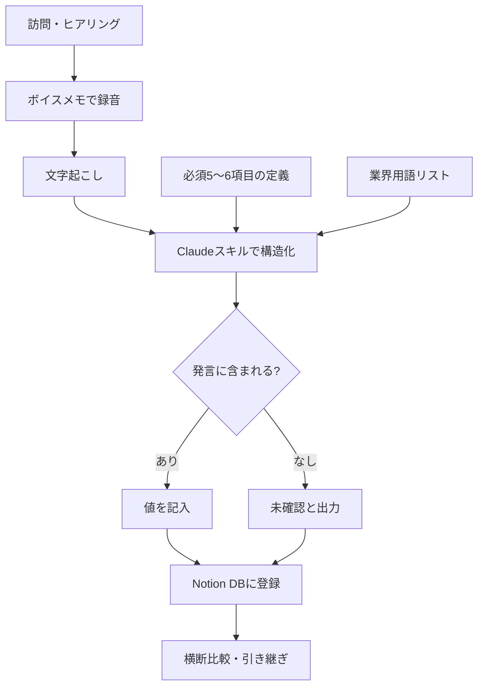

# ヒアリングメモを「録って終わり」にしない仕組み:ボイスメモ→構造化→Notion登録までを自作した話

AIコンサルや営業のヒアリングで、せっかく録音したのに後で文字起こしを眺めるだけで終わっていませんか。この記事は、製造業の現場で働きながらAIコンサルを副業でやっている筆者が、ヒアリングメモアプリにNotion連携とClaudeのスキル化を足して「録音から案件データベースまで一直線」にした実装記録です。中小企業で顧客訪問や現場ヒアリングを抱えている方が、そのまま真似できる手順にまとめました。

**図：ボイスメモから Notion 蓄積までの導線**

## そもそも何が課題だったのか

ヒアリングの記録には、たいてい3つの段階があります。

1. **録る**(ボイスメモ、手書きメモ)
2. **整える**(文字起こし、要点の抽出)
3. **貯める・引き出す**(あとで検索できる形にする)

多くの人が詰まるのは3番目です。筆者も、ボイスメモアプリに録音データが溜まり、文字起こしテキストがメモアプリに散らばっている状態でした。2回目の訪問前に「前回、この会社は何に困ってると言っていたか」を思い出すのに、録音を頭から聞き直す羽目になる。これが一番のムダでした。

本当に欲しかったのは、**ヒアリングの内容が「比較できる形」で並んでいる状態**です。A社とB社の課題を横に並べて、共通項を見つけたい。前回の訪問から何が変わったかを一目で見たい。そのためには、自由文のメモではなく、項目が揃った構造化データにする必要があります。

ここで言う「構造化」は難しい話ではなく、要するに**毎回同じ項目で埋める表にする**ということです。

## 作ったものの全体像

今回、学習日の作業で実装したのは次の4つです。

- **ヒアリングメモアプリへの項目追加**(聞くべき項目を増やし、抜け漏れを減らす)
- **Notionデータベースの作成**(ヒアリング結果の蓄積先)
- **Claudeスキル化**(文字起こしテキストを決まった項目に整形する処理を、呼び出すだけで使える形にする)
- **iPhoneアプリへの移植**(現場・移動中にその場で使えるようにする)

導線としては、

> ボイスメモで録音 → 文字起こし → Claudeのスキルで構造化 → Notionのデータベースに登録

という一本道です。それぞれは既存のツールで、特別なものは使っていません。やったのは**つなげたこと**だけです。ただ、このつなげる作業こそが、実務で効いてくる部分でした。

## 手順:同じものを作るなら

### ステップ1:聞く項目を先に決める

アプリやツールをいじる前に、紙でもいいので「毎回必ず聞くこと」を決めます。筆者は既存のヒアリングメモアプリに項目を追加するところから始めました。

AIコンサルのヒアリングなら、例えばこういった軸です。

- 会社名・部署・担当者の役職
- 現在の業務の流れ(誰が、何を、どの頻度で)
- 困っていること(本人の言葉そのまま)
- すでに試したこと・使っているツール
- 判断する人は誰か
- 次のアクション

ポイントは、**「困っていること」は要約せず本人の言葉を残す**ことです。要約すると、後から読み返したときにニュアンスが消えます。

### ステップ2:Notionにデータベースを作る

ステップ1で決めた項目を、そのままNotionのデータベース(表形式でデータを貯められるNotionの機能)のプロパティ(列)にします。

- テキスト型:会社名、課題、現状の業務フロー
- 選択型:業種、商談フェーズ
- 日付型:ヒアリング日、次回アクション期限

選択型(セレクト)を使える項目は、できるだけ選択型にしておくと後で絞り込みが効きます。ここをテキストにすると、表記ゆれで検索に引っかからなくなります。

### ステップ3:Claudeのスキルとして整形処理を登録する

ここが今回の肝です。文字起こしした長文テキストを、ステップ1の項目に沿って埋めてもらう指示を作り、それをClaudeの「スキル」として登録しました。スキルにしておくと、毎回長いプロンプト(指示文)を貼り直さずに、呼び出すだけで同じ処理が走ります。

指示の中身で意識したのは次の点です。

- 出力の形式を固定する(Notionに貼りやすいキー:値の形)
- **聞けていない項目は「未確認」と出力させる**(勝手に埋めさせない)
- 顧客の発言は要約せず引用で残す欄を作る

### ステップ4:iPhoneで完結させる

最後に、同じ仕組みをiPhoneから使えるように移植しました。ヒアリングは外出先です。会社に戻ってPCを開く前提だと、確実に後回しになります。**訪問が終わって駐車場に戻った10分で登録が終わる**状態が目標でした。

## つまずいた点と解決

### 1. AIが「聞いていないこと」を埋めてしまう

最初に一番困ったのがこれです。文字起こしテキストを渡して項目を埋めさせると、会話に出てこなかった項目まで、それらしい内容で埋まってきます。ヒアリングメモとしては致命的で、後から「この会社、予算いくらって言ってたっけ」と見返したときに、AIの推測を事実だと思い込むリスクがあります。

**解決策**は、指示文に「発言に含まれない項目は必ず『未確認』と出力。推測で補完しない」と明記したうえで、出力形式自体に「未確認」という選択肢を組み込んだことです。空欄を許すのではなく、**「未確認」という値を能動的に書かせる**のがコツでした。空欄だと「埋め忘れ」なのか「聞けなかった」のか区別がつきません。

### 2. 項目を増やしすぎて現場で使えない

アプリの項目追加は楽しくなってしまい、つい細かく増やしました。ところが実際のヒアリングでは、会話の流れでしか聞けないことのほうが多く、項目が多いと「埋める作業」になって会話がぎこちなくなります。

結果として、**必須項目と任意項目を分ける**形に戻しました。必須は5〜6個まで。それ以外は埋まればラッキー、という扱いです。

### 3. 文字起こしの精度に引きずられる

製造業の現場ヒアリングは、機械名や工程名など固有名詞が多く出ます。文字起こしがこれを誤変換すると、構造化の結果も崩れます。

対策は単純で、**よく出る用語のリストを指示文に添える**ことです。「この文章には以下の用語が登場する可能性があります」と列挙しておくと、誤変換の補正が効きやすくなりました。完璧にはなりませんが、手直しの量は減ります。

## 明日から使えるチェックリスト

ツールを作らなくても、考え方だけ真似できます。

- [ ] 次の訪問で「毎回必ず聞く項目」を5〜6個、紙に書き出す
- [ ] その項目をそのままNotion(またはスプレッドシート)の列にする
- [ ] 列は、選択肢にできるものは選択型にする(表記ゆれ防止)
- [ ] 文字起こしテキストを整形する指示文を1つ作り、使い回せる場所に保存する
- [ ] 指示文に「発言にない項目は『未確認』と出力。推測しない」を入れる
- [ ] 顧客の発言を要約せず残す欄を1つ作る
- [ ] 業界用語・機械名のリストを指示文に添える
- [ ] スマホだけで登録まで完結するか、実際に1件やってみる
- [ ] 1週間使って、埋まらない項目は削る

最後の「埋まらない項目は削る」が意外と重要です。設計時の理想ではなく、実際の会話で取れる情報に合わせて削っていくほうが、長く続きます。

## この仕組みが解決する実務の課題

一番大きいのは、**担当者の頭の中にしかない顧客情報を、形にして残せる**ことです。中小企業では、お客さんの事情を知っているのが一人だけ、というケースがよくあります。その人が休んだり異動したりすると、ゼロから聞き直しになる。構造化されたヒアリング記録があれば、少なくとも「前回何を話したか」は引き継げます。

もう一つは、**案件の横断比較**です。項目が揃っていれば、「同じ課題を持つ会社が3社ある」といった気づきが出てきます。これは提案の質に直結します。

## まとめ

ヒアリングは「録ること」ではなく「後から比較できる形で貯めること」が本番です。
AIに整形させるときは、推測で埋めさせない指示を必ず入れてください。
そして、スマホだけで完結する導線にしないと、結局やらなくなります。

<!-- REVIEW:START -->
## 🔍 公開前チェック（自動精査）

### 事実確認
- [ ] 「製造業の現場で働きながらAIコンサルを副業でやっている筆者」→ 素材に職業・業種の記載なし。プロフィールとして事実か要確認（以降の「製造業の現場ヒアリング」「機械名や工程名」も同根）。
- [ ] 「必須は5〜6個まで」「必須項目と任意項目を分ける形に戻しました」→ 素材は「項目追加」のみ。数値・設計方針は裏付けなし。
- [ ] 「つまずいた点と解決」3件（AIが未発言項目を埋める／項目を増やしすぎ／文字起こしの誤変換）→ 素材に一切記載なし。実際に遭遇した問題か、一般論の創作かの切り分けが必要。
- [ ] 「『未確認』と出力。推測で補完しない」「よく出る用語のリストを指示文に添える」→ スキルの具体的な指示内容は素材になし。実装済みか要確認。
- [ ] 「テキスト型:会社名、課題…選択型:業種、商談フェーズ 日付型:ヒアリング日」→ Notion DBの具体プロパティ構成は素材に記載なし。実際のDB定義と突き合わせを。
- [ ] 「1週間使って、埋まらない項目は削る」「手直しの量は減りました」→ 素材は1日の実装ログで運用結果の記録なし。運用後の知見として書けるか要確認。

### 主張・表現
- [ ] 「中小企業で顧客訪問や現場ヒアリングを抱えている方が、そのまま真似できる手順」→ 実際の手順詳細（スキルの定義方法、iPhone移植の方式）が本文にないため、約束が過大。
- [ ] 「訪問が終わって駐車場に戻った10分で登録が終わる」→ 数値の根拠なし。「目標でした」と書かれているが、達成したと読まれやすい。
- [ ] 「これは提案の質に直結します」→ 効果の断定。実例がないので「期待できる」程度への緩和を推奨。
- [ ] 「最初に一番困ったのがこれです」→ 体験の強調だが素材に対応記述なし。断定トーンの見直しを。

### 構成・読みやすさ
- [ ] 「手順:同じものを作るなら」と「明日から使えるチェックリスト」が内容的にほぼ重複。チェックリストを要約に徹するか、片方を圧縮。
- [ ] mermaid図に「必須5〜6項目の定義」「業界用語リスト」など、素材で裏付けのない要素が含まれる。本文修正時は図も同期を。
- [ ] 「Claudeのスキル」は初出で未説明のまま冒頭に登場。ステップ3の説明を前倒しするか、冒頭に一言補足を。
- [ ] タイトルは「Notion登録まで自作した話」だが、iPhone移植パートが数行のみで薄い。配分の見直しを。
- [ ] 冒頭「〜終わっていませんか」の問いかけ＋課題提示が長め。本題（作ったもの）までを短縮できる。

### 総合判定
- [ ] **事実確認必須**。導線の骨格（項目追加・Notion DB・Claudeスキル化・iPhone移植）は素材と一致するが、筆者属性・つまずき3件・項目数・運用結果など記事の大半が素材に裏付けを持たない。執筆者本人による裏取り後に公開を。
<!-- REVIEW:END -->

