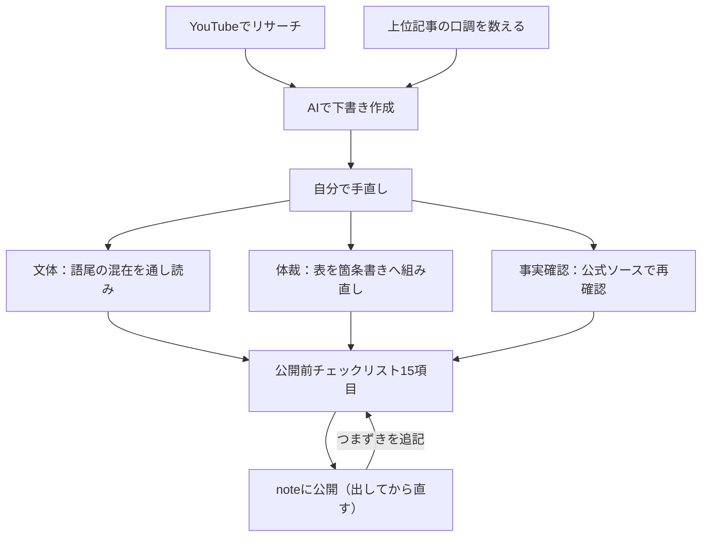

# 初めてのnote公開でつまずいた15項目——AI下書きを「自分の文章」に直す実務手順

AIに記事の下書きを書かせたものの、そのまま公開する勇気が出ない。そんな方向けに、製造業の現場で働きながらAI研修をしている筆者が、初めてnoteを公開するまでに実際につまずいた点と、それをチェックリストに落とし込んだ過程をそのまま共有します。中小企業で「AIで情報発信を効率化したい」と考えている方の、最初の一歩の参考になればと思います。

**図：AI下書きを「公開できる記事」にするまでの流れ**

## やったこと：調査→下書き→手直し→公開の4ステップ

今回のテーマは「インスタ収益化」。工程はシンプルで、以下の4つです。

1. **YouTubeでリサーチ**：関連する解説動画を複数見て、内容を自分用にまとめる
2. **まとめを素材にAIで下書き**：リサーチメモを渡して記事構成と本文のたたき台を作る
3. **自分で手直し**：口調、構成、事実確認を一つずつ直す
4. **noteに投稿して公開**

製造業でいえば、1が「調査・要求仕様の整理」、2が「試作」、3が「検査・手直し」、4が「出荷」にあたります。今回いちばん時間がかかったのは、意外にも3の手直しと4の公開作業でした。AIが下書きを出すところまでは速いのですが、「人様に出せる状態」にするまでの距離が思ったより遠かった、というのが率直な感想です。

## 口調は「好み」ではなく「数えて」決めた

最初に悩んだのが文体です。「です・ます」か「だ・である」か、絵文字は使うか、一人称は何にするか。ここを感覚で決めると、書いている途中でブレます。

そこで取った方法が、**noteで同じテーマの上位記事を実際に開いて、口調を数える**というやり方です。

- 検索して上位に出てくる記事を一定数ピックアップする
- 敬体（です・ます）か常体（だ・である）か、どちらが多いかを数える
- 一人称、絵文字の有無、見出しの付け方もあわせて見る
- テーマごとに傾向が違うので、「note全体」ではなく「このテーマの上位記事」に限定して数える

これはQC（品質管理）でいう現物確認と同じ発想です。「たぶんこうだろう」で決めず、実際のサンプルを見て多数派を把握する。数えた結果にそのまま従えば、少なくとも「浮いた文体」にはなりません。

そしてこの作業の副産物として、**AIへの指示が具体的になりました**。「読みやすく書いて」ではなく「敬体、一人称は◯◯、絵文字なし、見出しは問いかけ形式」と数えた結果を伝えられるので、下書きの品質が目に見えて上がります。AIに曖昧な指示しか出せないのは、たいてい自分の中で基準が決まっていないからだ、と気づかされました。

## 公開作業で初めて分かった3つの落とし穴

下書きができてからが本番でした。実際に公開作業をして、初めて分かったことが3つあります。

### 1. noteでは表（テーブル）が使えない

AIに下書きを作らせると、比較情報を自然とMarkdownの表形式でまとめてくれます。見やすいので、そのまま使うつもりでした。ところがnoteのエディタに貼り付けたところ、表として表示されません。

対処として、表の中身を**箇条書きに組み直し**ました。「項目A：説明」「項目B：説明」という形に展開するか、どうしても比較が必要なら画像にする。これは「AIの出力は、公開先のプラットフォームの制約を知らない」という当たり前の事実に気づかされた瞬間でした。AIは一般的に正しいMarkdownを出しますが、noteで動くかどうかは別問題です。

### 2. 口調が途中で混在する

前半は敬体で統一されているのに、後半に常体の文が混じる。あるいは自分で手直しした箇所だけ文体が変わる。通して読み返すまで気づきませんでした。

AIの下書きに自分で加筆していくと、**加筆部分は「自分の素の口調」になりがち**です。ここは機械的に、公開前に必ず通し読みして語尾だけを追う工程を入れることにしました。

### 3. 情報は公式ソースで再確認する

YouTubeのリサーチをもとにした記事なので、制度や条件の数字が出てきます。動画は作られた時点の情報で、その後に変わっている可能性があります。AIの下書きも同様に、学習時点の古い情報が混ざることがあります。

結局、**数字と条件は公式の情報を自分で開いて確認する**しかありません。ここは時短できない工程だと割り切りました。AIで時間を浮かせた分を、事実確認に回すイメージです。

## つまずいた点と解決

まとめると、今回のつまずきと対処は次の通りです。

| つまずき | 原因 | 解決 |
|---|---|---|
| 文体が決まらない | 自分の中に基準がなかった | 上位記事の口調を数えて多数派に合わせた |
| 表が表示されない | AIはプラットフォーム制約を知らない | 箇条書きに組み直した |
| 口調が混在した | 自分の加筆部分が素の口調に戻る | 公開前に語尾だけ通し読みする工程を追加 |
| 情報の鮮度が不安 | 動画・AIともに時点の情報 | 数字と条件は公式ソースで再確認 |

そして、この一回限りの反省で終わらせないために、**公開前チェックリストを15項目にまとめました**。現場でいう作業標準書と同じで、「次に同じことをやるときに迷わないため」の記録です。初回に気づいたことをその場で文書化しておかないと、二回目にまた同じ場所でつまずきます。

## 明日から使えるチェックリスト

筆者が作った15項目をベースに、どんな媒体でも使える形で整理しました。公開ボタンを押す前に、上から順に確認してください。

**【文体】**
1. 同テーマの上位記事を数え、敬体／常体の多数派を確認したか
2. 一人称を決めて統一したか
3. 絵文字・記号の使用方針を決めたか
4. 通し読みして語尾の混在がないか確認したか
5. AI下書きと自分の加筆部分で文体が変わっていないか

**【表示・体裁】**
6. 表（テーブル）が表示される媒体か確認したか
7. 表が使えない場合、箇条書きか画像に置き換えたか
8. 見出しの階層が崩れていないか
9. スマホ表示で読んでみたか
10. 改行・段落の間隔が詰まりすぎていないか

**【事実確認】**
11. 数字・金額・条件を公式ソースで再確認したか
12. 情報の「いつ時点か」を本文に明記したか
13. 断定できない内容に、断定表現を使っていないか

**【公開前の最終確認】**
14. タイトルと中身が一致しているか
15. 公開後に直せる前提で、まず出す覚悟ができているか

15番は精神論のようですが、重要だと思っています。完璧を目指すと公開できません。noteは公開後の編集ができるので、**出してから直す**前提で踏み切りました。

## この学びが実務のどんな課題を解決するか

中小企業でAI活用が止まる典型的なパターンが、「AIに下書きを作らせたが、そこから先どうしていいか分からず結局使わない」です。原因は、**出力を完成品にする工程が設計されていないこと**だと考えています。

今回やったことは、その工程を一度自分の手で通して、チェックリストという形で標準化しただけです。製造業でいえば、新しい設備を入れたら検査工程も合わせて作る——それと同じ話です。AIという設備を入れたなら、出てきたものを検査する手順も作らないと、ラインは回りません。

このチェックリストは記事に限らず、AIで作った提案書・社内マニュアル・顧客向け文書にもそのまま応用できます。「文体」「体裁」「事実確認」「最終確認」の4区分は、どんなアウトプットでも共通です。

## まとめ

AIの下書きは速いですが、公開可能な状態にするには別の工程が要ります。
初回の失敗は、その場でチェックリストに変えておくと二回目から効きます。
完璧を待たずに公開し、出してから直すほうが、結果的に早く進みます。

<!-- REVIEW:START -->
## 🔍 公開前チェック（自動精査）

### 事実確認

- [ ] 「製造業の現場で働きながらAI研修をしている筆者」→ 素材に筆者の属性に関する記載なし。記事全体の「製造業でいえば」「QC」「作業標準書」等の比喩も、この前提に依存しているため要確認。
- [ ] 「noteのエディタに貼り付けたところ、表として表示されません」→ 素材は「表が使えない」とのみ記載。貼り付けて確認したのか、仕様を調べて知ったのか、経緯の裏付けなし。また、note の表機能については公開時点の仕様を公式で再確認を（記事自身が「公式ソース確認」を説いているため整合性が問われる）。
- [ ] 「【文体】1〜5」「【表示・体裁】6〜10」等の15項目の具体的内容 → 素材は「15項目のチェックリストにした」という事実のみ。項目の中身は素材に一切なく、再構成されたものである可能性が高い。実際のリストと照合必須。
- [ ] 「スマホ表示で読んでみたか」「改行・段落の間隔」「見出しの階層」→ 素材に記載のない項目。実際にチェックリストに含まれていたか要確認。
- [ ] 「関連する解説動画を複数見て」「検索して上位に出てくる記事を一定数ピックアップ」→ 素材には本数・件数の記載なし。「複数」「一定数」とぼかしてはいるが、実際の調査規模と齟齬がないか確認を。
- [ ] 「noteは公開後の編集ができるので」→ 一般には正しいが、素材には「出してから直す」方針の記述なし。15番の項目自体も含め裏付け要確認。

### 主張・表現

- [ ] 「下書きの品質が目に見えて上がります」→ 比較・検証の記録が素材にない。「上がったと感じた」程度の表現が妥当。
- [ ] 「AIに曖昧な指示しか出せないのは、たいてい自分の中で基準が決まっていないからだ」→ 一般化が強い断定。「自分の場合は」と限定したい。
- [ ] 「中小企業でAI活用が止まる典型的なパターン」「原因は〜工程が設計されていないこと」→ 出典のない業界論。筆者の推測であることを明示するか削除を。
- [ ] 「どんなアウトプットでも共通です」「どんな媒体でも使える形で整理」→ 1回の初公開経験からの一般化としては過大。トーンを落とすのが安全。
- [ ] 「AIの下書きも同様に、学習時点の古い情報が混ざる」→ 一般論としては妥当だが、今回実際に古い情報を発見したのかは素材から読み取れない。実体験として書くなら具体例が必要。

### 構成・読みやすさ

- [ ] 「公開作業で初めて分かった3つの落とし穴」と「つまずいた点と解決」の表が内容的にほぼ重複。表側を圧縮するか統合を。
- [ ] 記事本文が「noteでは表が使えない」と述べながら、自身が**Markdownの表**を使用している。noteに掲載するなら、この表こそ箇条書きに組み直す必要あり（最優先）。
- [ ] mermaid図も同様に、note上で描画されるか要確認。表示されない場合は画像化を。
- [ ] タイトル「つまずいた15項目」と中身のズレ：つまずきは3〜4点で、15はチェックリストの項目数。「つまずきから作った15項目のチェックリスト」等に修正したい。
- [ ] 本題のテーマ「インスタ収益化」が冒頭で一瞬触れられるのみ。読者が内容を期待する可能性があるため、扱いを明確に（リサーチ対象であって本記事の主題ではない旨を補足）。

### 総合判定

**要修正**（15項目の実内容と筆者属性については**事実確認必須**）。特に、記事内の表をnote用に組み直す点と、素材にない15項目の中身の照合を公開前に行ってください。
<!-- REVIEW:END -->

