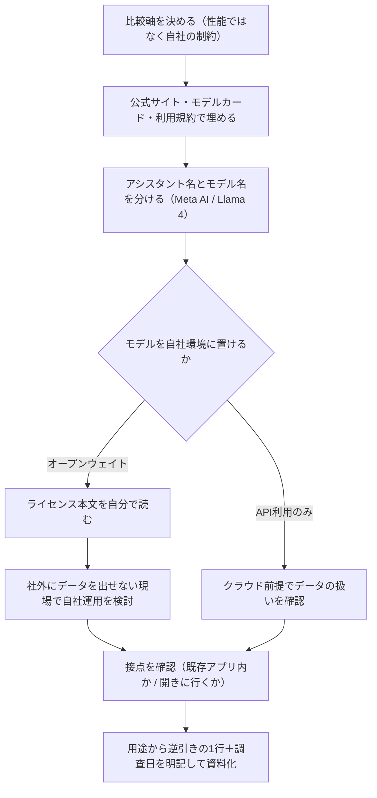

# Meta AIは他のAIと何が違うのか：ChatGPT・Claude・Geminiと比べて分かった「自社運用」と「接点」の違い

「ChatGPTとClaudeとGeminiは触ってみたけど、Meta AIって結局何なの？」という質問を、中小企業の経営者の方から立て続けに受けました。自分も説明できなかったので、一次情報を当たって比較資料にまとめ直しました。その過程で分かったこと、そして資料作りで盛大につまずいた点を共有します。

**図：新しいAIを自社向けに評価する流れ（Meta AIの比較で使った手順）**

## きっかけ：比較表からMeta AIだけ抜け落ちていた

研修で使っている「主要AIの使い分け」資料には、ChatGPT・Claude・Geminiの3つしか載せていませんでした。理由は単純で、自分が業務で使っていなかったからです。

ただ、現場の方から「スマホのInstagramに出てくるAIマークは何ですか」と聞かれたとき、答えに詰まりました。使っていなくても、社員のスマホにはすでに入っている。これは説明責任があるな、と思ってリサーチを始めました。

## リサーチして見えた、決定的に違う2点

比較してみると、Meta AIは他3つとは「競争している土俵が少し違う」ことが分かりました。

### 1. モデルが「オープンウェイト」である

最大の違いはここでした。Meta AIの頭脳にあたるのがLlama（ラマ）シリーズで、最新世代がLlama 4です。これが**オープンウェイト**、つまりモデルの中身（学習済みのパラメータ）が公開されていて、ダウンロードして自社のサーバーで動かせます。

ChatGPT・Claude・Geminiは基本的にクラウド経由のAPI利用で、モデル本体は手元に来ません。一方Llamaは、条件を満たせば自社環境に置ける。これは「社外にデータを出せない」という製造業で何度も直面してきた壁に対する、現実的な選択肢になります。

ここで初心者の方が混同しやすいのが、

- **Meta AI**＝一般ユーザー向けのAIアシスタント（アプリやSNSの中にいる）
- **Llama 4**＝その裏側にあるモデル本体。企業が自前で使えるのはこちら

という区別です。自分も最初ごちゃ混ぜにしていて、資料を一度書き直しました。

### 2. 「接点」の作り方がまったく違う

もう一つは配布のされ方です。ChatGPTやClaudeは「使おうと思って開きに行く」のに対し、Meta AIはInstagram・WhatsApp・Messengerといった既存アプリや、Metaのスマートグラスに**最初から入っている**状態で届きます。

これは「AIを使わせる難しさ」を考えると見逃せない点です。研修現場で一番苦労するのは、新しいツールを開く習慣を作ることです。すでに毎日開いているアプリの中にAIがあるというのは、その障壁がない。企業向けの業務利用というより、生活者の行動の中にAIを置く設計だと理解しました。

## 比較資料をどう作ったか（手順）

再現できるよう、実際の進め方を残しておきます。

1. **軸を先に決める**。性能ではなく「中小企業が判断に使う軸」にしました。具体的には、モデルを自社で持てるか／どこで使えるか／データの扱い／コスト構造／日本語での使い勝手、の5つです。
2. **公式情報から埋める**。各社の公式サイト・モデルカード（モデルの仕様書）・利用規約を一次情報として先に読み、ブログ記事やまとめサイトは後回しにしました。
3. **空欄は空欄のまま残す**。分からない項目を推測で埋めない。これは後述のつまずきの反省です。
4. **「どんな会社にどれ」を1行で書く**。表だけ渡しても判断できません。「社外にデータを出せない製造現場で試作するならLlama系の自社運用を検討」のように、用途から逆引きできる形にしました。
5. **作成日を明記する**。AIの仕様は数か月で変わります。資料の冒頭に調査日を入れておくと、後から見た人が誤解しません。

## つまずいた点と解決

**つまずき1：ベンチマークの数字に引っ張られた**
最初はベンチマーク（性能テストの点数）の比較表を作っていました。でも、経営者に見せる資料としてはほぼ意味がありません。「で、うちはどれを使えばいいの？」に答えられないからです。軸を「性能」から「自社で持てるか・どこで使えるか」に切り替えたら、資料が一気に使えるものになりました。

**つまずき2：「オープンウェイト」＝「完全に自由」と誤解しかけた**
ダウンロードできる＝何でもOK、ではありません。ライセンスには利用条件があり、事業規模や用途によって制約がかかる場合があります。資料には「自社運用を検討する場合は、必ず最新のライセンス本文を読むこと」と注記を入れました。**便利そうな部分だけ切り取って説明しない**、これは実務家として外せない線引きだと思っています。

**つまずき3：言葉の定義が曖昧なまま書き進めた**
前述の「Meta AI」と「Llama」の混同です。これを曖昧にしたまま書くと、読んだ人が「SNSのAIを自社サーバーに入れられる」と誤読します。用語定義のブロックを冒頭に独立させて解決しました。

## 明日から使えるチェックリスト

新しいAIを自社で評価するとき、そのまま使える形にしました。

- [ ] そのAIの「アシスタント名」と「中身のモデル名」を分けて書けるか
- [ ] モデルは自社環境に置けるか（オープンウェイトか、API利用のみか）
- [ ] 社員が「わざわざ開く」必要があるか、既存ツールの中にあるか
- [ ] 入力したデータが学習に使われるか、公式ドキュメントで確認したか
- [ ] ライセンス・利用規約の本文を自分で読んだか（要約記事だけで判断していないか）
- [ ] 比較軸は「性能スコア」ではなく「自社の制約」になっているか
- [ ] 資料に調査日を書いたか

## まとめ

Meta AIの差別化点は、性能ではなく「モデルを自社で持てること」と「既存アプリの中に最初からあること」でした。
社外にデータを出せない企業にとって、オープンウェイトは現実的な選択肢になります。
ただし自由に使えるわけではないので、ライセンス本文を自分の目で読むところまでをセットにしてください。

<!-- REVIEW:START -->
## 🔍 公開前チェック（自動精査）

### 事実確認
- [ ] 「中小企業の経営者の方から立て続けに受けました」「スマホのInstagramに出てくるAIマークは何ですか」→ 素材に質問を受けた経緯の記載なし。実体験かエピソード創作か要確認。
- [ ] 「研修で使っている『主要AIの使い分け』資料には、ChatGPT・Claude・Geminiの3つしか載せていませんでした」→ 既存研修資料の存在は素材に無し。
- [ ] 「Instagram・WhatsApp・Messenger」→ 素材は「SNS」とのみ。具体名3つは確認した事実か要チェック。
- [ ] 「5つの軸（自社で持てるか／どこで使えるか／データの扱い／コスト構造／日本語での使い勝手）」「モデルカード・利用規約を一次情報として先に読み」→ 素材に手順・軸の記載なし。実際の作業内容と一致するか確認。
- [ ] つまずき3点（ベンチマーク比較表を作った／ライセンス誤解／用語混同で資料を書き直した）→ いずれも素材に無い。特に「資料を一度書き直しました」は具体的な作業事実なので要確認。
- [ ] 「最新世代がLlama 4」→ 素材はLlama 4に言及するのみで「最新世代」とは書かれていない。公開時点のバージョン状況を再確認（学習日が2026-09-16のため陳腐化リスク大）。

### 主張・表現
- [ ] 「ChatGPT・Claude・Geminiは基本的にクラウド経由のAPI利用で、モデル本体は手元に来ません」→ 各社ともオープンウェイトモデルを別途公開している状況があり、断定は危険。「主力モデルは」等の限定が必要。
- [ ] 「条件を満たせば自社環境に置ける」と「ライセンスに制約」の説明は良いが、「社外にデータを出せない製造現場で試作するならLlama系の自社運用を検討」は読者が即断しかねない推奨になっている。注記の位置を前倒ししたい。
- [ ] 「製造業で何度も直面してきた壁」→ 書き手の経歴が素材から不明。事実なら残し、そうでなければトーンを下げる。
- [ ] 「生活者の行動の中にAIを置く設計だと理解しました」→ 「理解しました」と主観に落としているのは良い。断定表現への差し替えは不要。

### 構成・読みやすさ
- [ ] 冒頭のmermaid図と「比較資料をどう作ったか（手順）」がほぼ同内容。どちらかに集約すると冗長さが減る。
- [ ] 「Meta AI / Llama」の区別説明が、本文中（1.の後半）と「つまずき3」で重複。つまずき側は1行参照で足りる。
- [ ] 記事内チェックリストが `- [ ]` 形式で、公開媒体によっては本文のチェックボックスと混同される。箇条書き記号への変更を検討。
- [ ] タイトルが長く要素過多（「自社運用」と「接点」）。サブタイトル部分を短縮すると訴求が明確になる。
- [ ] 「オープンウェイト」「モデルカード」は説明済みで良いが、「スマートグラス」が具体的にどの製品かは未説明。製品名を出すか、出さないなら一般名詞のままで統一を。

### 総合判定
- [ ] **事実確認必須** — 技術的な骨子（Llama 4＝オープンウェイト／SNS・スマートグラス統合）は素材と一致するが、エピソード・5つの軸・3つのつまずき・アプリ名など具体記述の大半が素材で裏付けられない。体験部分の真偽確認後に公開を。
<!-- REVIEW:END -->

